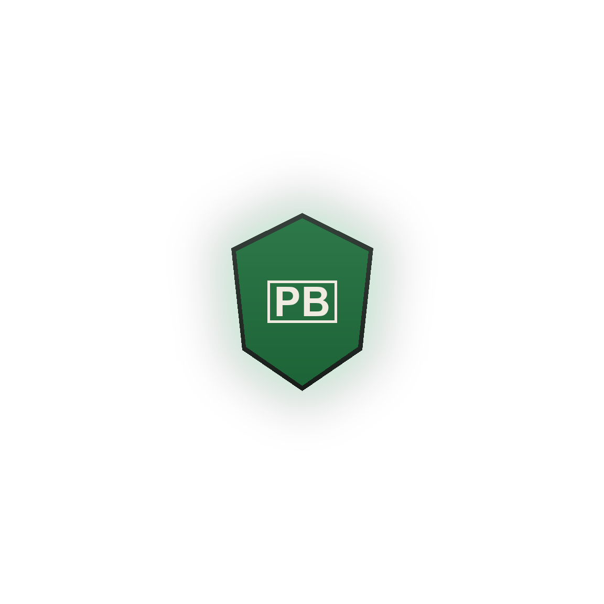

<div align="center">
  

  <h1>Parcelbonia</h1>

  <p>Mobile app for the PB-01 smart parcel receiver</p>
</div>

Parcelbonia is a smart parcel box that safely receives deliveries while you're
away. This Flutter app is its remote control center. With it you can:

- **Watch the box live**: parcel presence, weight, door state, battery and the
  components hub temperature.
- **Unlock it remotely** and switch between Auto, Maintenance and Sleep modes.
- **Give riders a one-time code**: six-digit time-based codes that the box
  checks offline, with no Wi-Fi needed.
- **Keep the electronics cool**: intake and exhaust fans turn on automatically
  at a temperature you set.
- **Test the hardware**, manage RFID cards, and review delivery and access
  history.

The app talks to the box through Firebase Realtime Database, and the box's ESP
module relays commands to an Arduino Pro Mini.

## Getting started

```bash
git clone https://github.com/alphrancis/parcelbonia-app.git
cd parcelbonia-app
flutter pub get
cp lib/secrets.example.dart lib/secrets.dart   # then add your rider-code secret
flutter run
```

In Firebase, enable **Anonymous** sign-in, because the app opens straight to the dashboard without a login.
